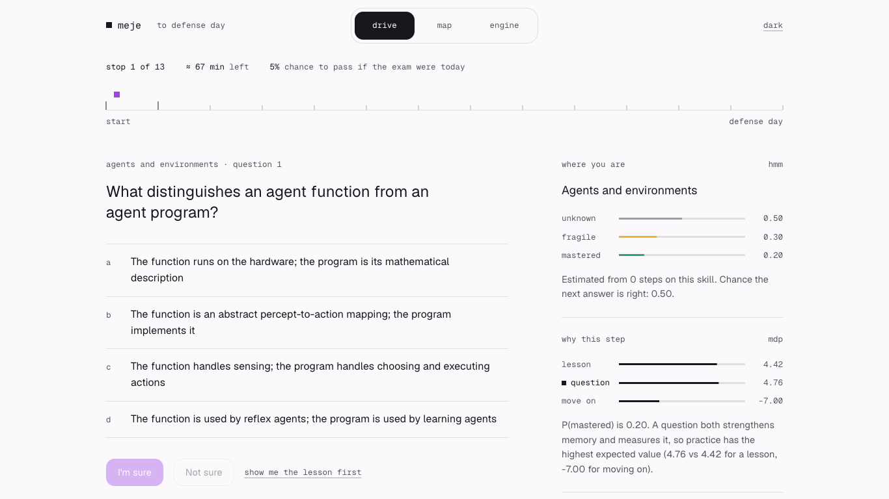
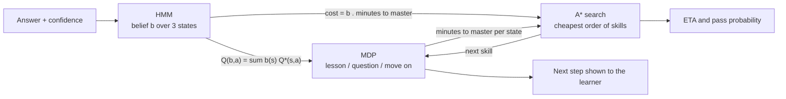

# Meje: a GPS for learning

Meje finds out what you actually know, plans the shortest route to your exam, and picks each next step. Three classical AI algorithms do the work, and every number behind every decision is on screen.

**Live demo: https://meje-delta.vercel.app**

[](https://github.com/user1618phi/meje/actions/workflows/tests.yml)

*Meje* (меже) is Kazakh for a milestone: the mark you set and move toward. Final project for AI Fundamentals (AIF1303), QAIRU, 2026.



| A GPS needs to | Meje's answer | Course topic |
|---|---|---|
| know where you are, from noisy signals | **Hidden Markov model**: forward filtering and Viterbi over `unknown / fragile / mastered` | Week 7 (with Bayes' rule, week 6) |
| plan the cheapest route to the destination | **A\* search** over sets of completed skills, with an admissible and consistent heuristic | Week 2 |
| decide what to do at each moment | **Markov decision process** solved by value iteration: lesson, question or move on | Week 5 |

## Quick start

Python 3.10 or newer. No packages to install: the engine and the server use the standard library only.

```bash
git clone https://github.com/user1618phi/meje.git
cd meje
python -m meje
```

The app opens at `http://127.0.0.1:8000`. Other commands:

```bash
python -m meje demo                  # console walk-through: input -> key steps -> output for each algorithm
python -m unittest discover -s tests   # 90 tests, a few seconds
python -m meje experiments           # simulated learners; rewrites docs/results.json (seed 7)
python -m meje realdata              # real learners; downloads ASSISTments once, rewrites docs/results_real.json
python -m meje serve --port 8010     # another port
```

The interface has its own end-to-end check (needs Node, `npm i playwright` and Chrome): `node tools/e2e.mjs` walks every screen at five viewport sizes in both themes and fails on a console error, sideways scrolling, clipped text, a control hidden by the dock, a touch target under 40 px, or a broken flow.

## Sample input and output

`python -m meje demo` shows each algorithm as input, key steps and output. An excerpt:

```text
1. HIDDEN MARKOV MODEL  -  where is the learner?
Input: three answers on one skill: ['wrong_unsure', 'correct_unsure', 'correct_sure']
  answer 1: wrong_unsure
    prior      [0.500, 0.300, 0.200]
    likelihood [0.6000, 0.2450, 0.0320]   P(evidence) = 0.3799
    posterior  [0.790, 0.193, 0.017]   (Bayes' rule: likelihood x prior, normalised)
    predicted  [0.711, 0.195, 0.094]   (after the learning transition)
  ...
Output: belief [0.088, 0.202, 0.710]
        Viterbi path ['fragile', 'fragile', 'mastered', 'mastered'] (log probability -5.255)

2. MARKOV DECISION PROCESS  -  what should happen next?
  sweep   1: V = [-1.000, -1.000, 10.000]   largest change = 1.00e+01
  sweep  47: V = [3.028, 6.512, 10.000]   largest change = 8.68e-11
Output: policy {'unknown': 'explain', 'fragile': 'practice', 'mastered': 'advance'}
        on the belief above, Q(b, a) = {explain: 6.54, practice: 7.54, advance: 4.77} -> practice
        advancing starts to win at P(mastered) >= 0.885

3. A* SEARCH  -  which skill comes next?
Input: destination ['astar', 'bellman', 'viterbi']; state = set of completed skills; start = nothing completed
Output: route agents -> formulation -> heuristics -> uninformed -> ucs -> astar -> probability -> bayes -> markov -> hmm -> viterbi -> mdp -> bellman
        cost 66.9 minutes
        UCS     cost   66.9  expanded   453
        Greedy  cost   69.1  expanded    13
        BFS     cost   66.9  expanded   392
        A*      cost   66.9  expanded   117
```

Part 4 of the demo runs one session in which the three work together.

## What it does

1. **You pick a destination**, for example "Defense day" (A\*, Viterbi, value iteration) or "Final exam".
2. **You answer a question and say whether you are sure.** The two submit buttons are "I'm sure" and "Not sure", so confidence costs no extra click.
3. **The HMM updates its belief** about that skill with Bayes' rule. A lucky guess and a slip are both part of the model, so one answer never flips the verdict.
4. **The MDP picks the next step** by expected value: a short lesson when the skill is probably unknown, a question when it is fragile, moving on when it is probably mastered.
5. **A\* re-plans the route** with the new belief and shows the time left, the chance of passing if the exam were today, and the next stops.
6. **You stay in control.** Ask for the lesson, or study any unlocked skill now; the tutor prices the detour in minutes.
7. **Everything is inspectable.** The engine room shows the forward algorithm step by step, the Q table and the value-iteration sweeps, the A\* expansions with `g`, `h` and `f`, and a ledger of the tutor's forecasts against what happened.

It is not a chat. It never hands out an answer before an attempt.

## How the three algorithms work together



They are chained, not placed side by side. The belief sets both the action values and the cost of every edge in the route graph; the expected minutes come from evaluating the MDP's optimal policy; the route decides which skill the MDP acts on next.

| | Model | Solved by | Key output |
|---|---|---|---|
| HMM | 3 hidden states, 4 observations (right or wrong, sure or not), transitions that depend on the teaching action | Forward recursion, Viterbi in log space | Belief per skill, forecast of the next answer |
| MDP | 3 states, 3 actions, rewards in minutes, discount 0.95 | Value iteration (47 sweeps), then `Q(b,a)` on the belief (QMDP) | Policy `unknown -> lesson, fragile -> question, mastered -> move on`; moving on wins from P(mastered) >= 0.885 when P(unknown) is 0 |
| A\* | State = set of completed skills; hard prerequisites must come first, each missing soft prerequisite makes a skill 40% slower | `f = g + h`, `h` = base minutes of required skills still missing | Cheapest order of skills; same cost as uniform-cost search with far fewer states |

`python -m meje demo` prints a worked example of each with real numbers.

## Evidence

### Real learners

The knowledge model was fitted with Baum-Welch (written from scratch, `meje/realdata.py`) on 3,322 students of the public ASSISTments 2009-2010 data and asked to forecast 52,840 answers of 841 students it had never seen.

| Forecaster | AUC | Brier | Accuracy | Calibration error |
|---|---:|---:|---:|---:|
| Always the average | 0.500 | 0.2224 | 66.6% | 0.011 |
| Skill average | 0.629 | 0.2107 | 68.0% | 0.011 |
| Student's running average | 0.706 | 0.1989 | 69.3% | 0.056 |
| BKT, 2 states, fitted | 0.680 | 0.1996 | 70.5% | 0.016 |
| Meje HMM, assumed numbers | 0.685 | 0.2067 | 70.1% | 0.082 |
| Meje HMM, fitted | 0.681 | 0.1991 | 70.5% | 0.011 |
| **Meje HMM, fitted, prior per skill** | **0.709** | **0.1931** | **71.6%** | 0.012 |

Two honest readings. The fitted model with a prior per skill is the most accurate and stays calibrated. Fitted with one shared prior, the model learnt probabilities of a correct answer of `[0.27, 0.64, 0.81]`, close to the `[0.25, 0.65, 0.92]` assumed before seeing any data, except for more slips when mastered (0.81 against 0.92). But a student's own running average ranks answers almost as well (0.706 against 0.709), so the model's edge is calibration, not ranking. These logs test the knowledge model only: nobody in them was taught by this policy or this route.

### Simulated learners

20,000 simulated skills per rule, seed 7. Payoff is the reward for the true final state minus the minutes spent.

| Rule | Learners match the model | | Different numbers | | Different theory | |
|---|---:|---:|---:|---:|---:|---:|
| | minutes | payoff | minutes | payoff | minutes | payoff |
| **Meje (HMM + MDP)** | 6.48 | **1.97** | 8.87 | **-4.27** | 5.70 | **3.37** |
| Three correct in a row | 8.07 | 0.71 | 12.53 | -5.35 | 6.87 | 2.23 |
| Fixed dose (1 lesson, 3 questions) | 5.00 | -0.53 | 5.00 | -6.15 | 5.00 | 0.66 |
| Lessons only | 4.00 | -4.60 | 4.00 | -8.10 | 4.00 | -4.87 |
| Oracle (sees the hidden state) | 3.55 | 6.45 | 6.29 | 3.71 | 3.89 | 6.11 |

A rule tested on its own model wins by construction, so the second and third columns matter more. With wrong numbers the tutor keeps the best payoff among the simple rules but moves on too early more often (71.6% truly mastered against 90.9%). Simulation checks the implementation and compares rules; it is not evidence of learning gains in real students.

### Route search

Mean states expanded over 200 random learners per destination. A\* and uniform-cost search always return the same cost.

| Destination | A\* | UCS | BFS | Greedy finds the optimum | BFS finds the optimum |
|---|---:|---:|---:|---:|---:|
| Defense day (13 skills) | 145 | 445 | 392 | 43% | 94% |
| Final exam (20 skills) | 33 | 4,154 | 4,148 | 0.5% | 0% |

### Correctness

90 tests: the umbrella-world values 0.818 and 0.883 and the Viterbi path from Russell and Norvig; hand calculations; brute-force enumeration for Viterbi and for routes; closed-form MDP values and the contraction of the Bellman residual; admissibility and consistency of the heuristic on every reachable state of random graphs; Baum-Welch recovering known parameters; requests against a live server, including hostile ones; fuzzed and adversarial sessions; the same decisions under any hash seed. An independent review re-derived the HMM, MDP, search and Baum-Welch results by brute force; the twelve edge-case defects it found are fixed and each has a regression test.

## Repository map

```
meje/
  hmm.py         forward filtering, Viterbi, log-likelihood
  mdp.py         value iteration, policy evaluation, QMDP
  search.py      A*, UCS, greedy, BFS and the route problem
  readiness.py   exact pass probability (Poisson-binomial)
  tutor.py       the three algorithms chained; every parameter in TutorModel
  realdata.py    Baum-Welch and the held-out test on real answer logs
  simulate.py    simulated learners and the comparison of rules
  server.py      JSON API and static files, standard library only
  content.py     loads and validates a course pack
content/         skill graph, 20 micro-lessons, 80 questions (JSON)
web/             the interface: plain HTML, CSS and ES modules, no build step
tests/           90 tests
docs/            report, slides, design rationale, competition, results, media
tools/           end-to-end interface check, demo recording, PDF build, launch film
Dockerfile       container image: Python only, non-root
```

The server keeps no session state. The browser owns the history and sends it with each request, so the same history always gives the same decision, and the server stores nothing about a learner.

## Tools

They need Node, `npm i playwright marked`, Google Chrome and ffmpeg. Each starts and stops the app by itself.

```bash
node tools/e2e.mjs                 # interface check; BASE_URL=https://meje-delta.vercel.app checks the deployed copy
node tools/build_docs.mjs          # PDFs of the slides and documents
node tools/narrate.mjs             # narration clips; reads ELEVENLABS_API_KEY and ELEVENLABS_VOICE_ID from the environment
node tools/record_demo.mjs         # the demo film and the screenshots in docs/media
node tools/brag/render.mjs         # the 20-second launch film
```

## Running it for other people

The server is the same one command. It binds to this machine by default; `HOST` and `PORT` (or `--host`, `--port`) change that.

```bash
docker build -t meje .
docker run -p 8000:8000 meje
```

What is already in place: no third-party code at run time; a strict Content-Security-Policy and the usual security headers on every response; request bodies capped at 1 MB and rejected from the declared length; a 15-second socket timeout; malformed input ignored rather than fatal; no session state on the server, so any number of copies can run behind a load balancer; a `/health` endpoint; a non-root container user. What a public deployment still needs: rate limiting in front. The live demo runs the same handler as a serverless function on Vercel (`api/index.py`, `vercel.json`), which provides TLS.

## Adding a course

A course pack is two kinds of JSON file in `content/`: `skills.json` (skills with `hard` and `soft` prerequisites and destinations) and any number of `part_*.json` files with `lessons` and `items`. `content.py` rejects a pack with a cycle, an unknown skill, a missing lesson or an invalid answer key. No code changes are needed.

## Limitations

- The teaching parameters (how much a lesson or a question moves a learner) are assumed, not fitted. The real-data test covers the knowledge model, not the policy.
- QMDP ignores the value of information. One step of expectimax lookahead repairs this and is measured as an ablation (payoff 2.10 against 1.97 on matched learners); the product keeps plain QMDP because it can be explained in one line.
- No forgetting: knowledge never moves backwards in the model, so there is no spaced review yet.
- Multiple choice only, and the prerequisite graph is built by hand.
- No study with real learners using this tutor has been run.

## Roadmap

1. Fit the teaching parameters from Meje's own answer logs with the Baum-Welch code that is already here.
2. Add forgetting and spaced review.
3. A pilot with classmates before the final exam, publishing predicted against actual.
4. A Kazakh-language pack for the UNT, where several official attempts a year allow the forecast to be checked in public.

## Documents

- [Technical report](docs/REPORT.md) ([PDF](docs/Meje_Technical_Report.pdf))
- [Slides](docs/Meje_Slides.pdf)
- [Demo video, 2 minutes, narrated](docs/media/meje-demo.mp4)
- [Launch film, 20 seconds](docs/media/launch-film.mp4), with its [plan](docs/LAUNCH_FILM.md)
- [Design decisions and their reasons](docs/DESIGN.md)
- [Competition](docs/COMPETITION.md)
- [Defense notes](docs/DEFENSE.md)
- [Team contribution statement](docs/TEAM_CONTRIBUTION.md)

## Data and licences

Code: MIT. Fonts: SIL Open Font License 1.1. The ASSISTments 2009-2010 skill builder data is free for research use and is downloaded on demand, never redistributed here; cite Feng, Heffernan and Koedinger (2009), *User Modeling and User-Adapted Interaction* 19(3), 243-266.
