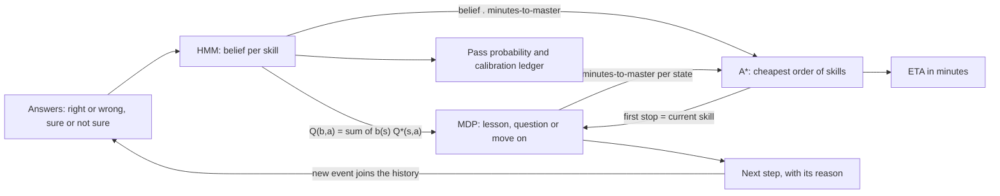
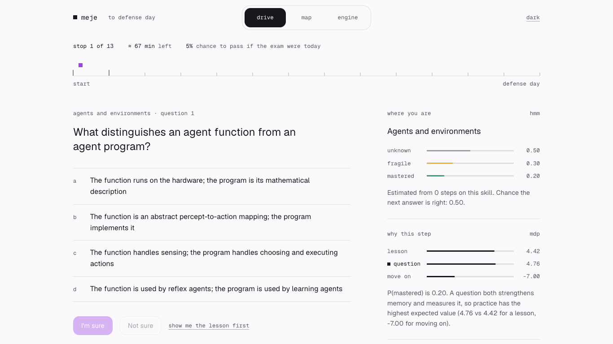
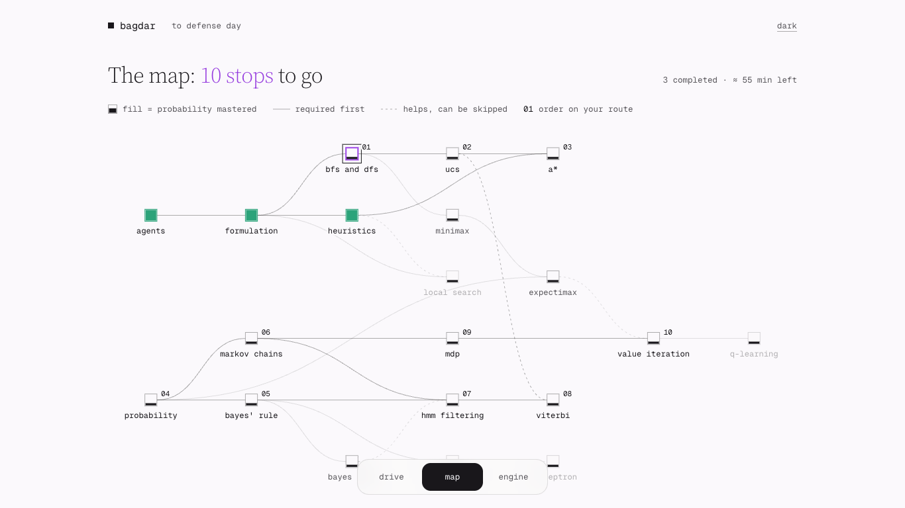

# Bagdar: a GPS for learning

Technical Report, final project

## 1. Project details

- **Student:** Mustafa Kassym (solo project), programme "Artificial Intelligence and Machine Learning"
- **Course:** AI Fundamentals (AIF1303), QAIRU, Astana, Trimester 1 of 2026-2027
- **Instructor:** Aizhan Sydykova
- **Date:** November 2026
- **Repository:** `https://github.com/user1618phi/bagdar`

## 2. Abstract

Bagdar ("bağdar", Kazakh for direction or bearing) is a study tool that works like a navigator. The learner picks a destination, such as defense day. A hidden Markov model estimates what the learner knows from noisy answers. A* search plans the cheapest order of skills through a prerequisite graph. A Markov decision process, solved by value iteration, chooses each step: a lesson, a question, or moving on. The three are chained through one quantity, the belief. The engine is checked by 81 unit tests, simulation with three kinds of learner, and a held-out test on public answer logs. The algorithms are classical. The contribution is their integration and an evaluation that states its limits.

## 3. Problem and objectives

A student preparing for an exam has to answer two questions alone: what do I actually know, and what should I do next? Chat assistants answer neither.

In a field experiment with about 1,000 high-school students, an unrestricted ChatGPT-like interface raised practice grades by 48% but lowered scores on the later exam without AI by 17%, compared with students who never had access. A version with guardrails largely removed the harm; it was not reported to beat the control [12]. A randomised trial of Khanmigo in 18 Tennessee schools found a gain of 1.3 national percentiles per semester, comparable to ordinary Khan Academy practice without AI [13]. Separately, Khan Academy has said that about 15% of students with access use Khanmigo regularly [14].

So the gap is not "more chat". It is a tool that keeps an explicit estimate of what the learner knows, plans from it, and can be checked.

| # | Objective | Measure | Result |
|---|---|---|---|
| 1 | Three course algorithms work toward one goal, each using another's output | Data flow (section 4), session trace (section 8) | Met |
| 2 | Each algorithm is correct | Textbook values, brute force, closed forms | 79 of 81 tests pass |
| 3 | Routes are optimal | A* cost equals UCS cost on 5 destinations x 200 belief profiles | 100% |
| 4 | The decision rule beats simple rules under the stated model, and its behaviour under a wrong model is reported | Payoff on three simulated learner types | Section 9.2 |
| 5 | Forecasts can be checked | Calibration error: simulated, model right; real logs, model fitted | 0.002; 0.012 |
| 6 | Runs with one command | Third-party packages required | None |

## 4. System overview



**Data flow.** Every answer is one of four observations. The HMM turns the events of each skill into a belief over unknown, fragile and mastered. The belief is used twice: the MDP's optimal Q-values are averaged over it to pick the action, and it is multiplied by the minutes the optimal policy needs from each state to price a skill for A*. The A* route decides which skill the MDP acts on.

**Stateless design.** The server holds no session. `Tutor.replay(targets, history)` is a pure function of the destination and the event history, which the browser keeps in `localStorage` and sends with each request. The same history always gives the same decision (tested), and a server restart loses nothing. Malformed events are ignored and counted, never fatal.

**Dependencies.** None at run time: the engine and the HTTP API use only the Python standard library (3.10 or newer), and the UI is plain JavaScript modules without a build step.

**Content.** The course pack is this course: 20 skills in five groups, 20 micro-lessons (idea, worked example, common trap), 80 four-option questions at three difficulty levels, and five destinations. There is one module per algorithm (`bagdar/hmm.py`, `mdp.py`, `search.py`), and every parameter lives in one dataclass, `TutorModel` in `bagdar/tutor.py`.

## 5. Algorithm 1: hidden Markov model (week 7, with Bayes' rule from week 6)

**Model.** One HMM per skill. Hidden states: unknown, fragile, mastered, with prior (0.50, 0.30, 0.20). This is Bayesian Knowledge Tracing [2] with three states instead of two, a variant already published [3].

Each answer carries correctness and a confidence mark ("I'm sure" or "Not sure"), giving four observation symbols. The emission table is built from `P(correct | state) = (0.25, 0.65, 0.92)`, `P(sure | state, correct) = (0.15, 0.45, 0.90)` and `P(sure | state, wrong) = (0.20, 0.30, 0.60)`:

| State | Correct, sure | Correct, not sure | Wrong, not sure | Wrong, sure |
|---|---|---|---|---|
| unknown | 0.0375 | 0.2125 | 0.6000 | 0.1500 |
| fragile | 0.2925 | 0.3575 | 0.2450 | 0.1050 |
| mastered | 0.8280 | 0.0920 | 0.0320 | 0.0480 |

Transitions depend on the teaching action, and knowledge never moves backwards:

| Action | From unknown | From fragile | From mastered |
|---|---|---|---|
| explain (lesson) | (0.35, 0.65, 0.00) | (0.00, 0.85, 0.15) | (0, 0, 1) |
| practice (question) | (0.90, 0.10, 0.00) | (0.00, 0.60, 0.40) | (0, 0, 1) |

A lesson helps a novice most; a question is what moves fragile knowledge to mastered, in line with the testing effect [11].

**Forward recursion.** One step does two things, in this order:

```
condition  b(x)  <- alpha * P(e_t | x) * b(x)            Bayes' rule; skipped for a lesson
predict    b(x') <- sum_x b(x) * P(x' | x, action_t)
```

The order matters. An answer is produced by the knowledge the learner had while answering, and learning from that question happens afterwards. This is exactly the BKT update [2]: posterior first, then the learning transition. The textbook writes the recursion as predict then update [1]; the two differ only by an index shift, and the same code reproduces the textbook numbers when the first step carries no evidence.

**Viterbi.** The most likely state sequence uses the same recursion with `max` in place of `sum`, plus back-pointers, in log space [4]. Filtering answers "where is the learner now"; Viterbi answers "what is the most likely story of how they got here".

**Worked example** (from `python -m bagdar demo`): three answers on one skill.

| Answer | Belief before | P(evidence) | After Bayes | After learning |
|---|---|---|---|---|
| wrong, not sure | [0.500, 0.300, 0.200] | 0.3799 | [0.790, 0.193, 0.017] | [0.711, 0.195, 0.094] |
| correct, not sure | [0.711, 0.195, 0.094] | 0.2294 | [0.658, 0.304, 0.038] | [0.592, 0.248, 0.159] |
| correct, sure | [0.592, 0.248, 0.159] | 0.2268 | [0.098, 0.320, 0.582] | [0.088, 0.202, 0.710] |

First row by hand: `0.5*0.6 + 0.3*0.245 + 0.2*0.032 = 0.3799`, so the posterior on unknown is `0.3/0.3799 = 0.790`. After the practice transition, unknown keeps `0.790*0.9 = 0.711`.

The Viterbi path is fragile, fragile, mastered, mastered, with log probability -5.255, which is `ln(0.3 * 0.245 * 0.6 * 0.3575 * 0.4 * 0.828)`. Filtering put 0.79 on unknown after the first answer, but once all three answers are seen, the best single explanation starts in fragile.

**Why selected.** Answers are noisy: a learner who knows nothing is right 25% of the time on four options, and one who has mastered a skill still slips 8% of the time. A score cannot separate these cases; a belief can, and a belief is what the planner needs.

**Complexity.** `O(T * S^2)` time for both algorithms, with `S = 3`.

## 6. Algorithm 2: Markov decision process (week 5)

**Model.** States are the same three. Actions: explain, practice, advance. Transitions are the two tables above; advance ends the episode. Rewards are minutes: explain costs 2, practice costs 1, and advancing pays (-15, -5, +10) from unknown, fragile and mastered. Discount `gamma = 0.95`. Using time as the cost follows earlier work on teaching as planning [7].

```
Q(s, a)       = R(s, a) + gamma * sum_s' P(s' | s, a) * V(s')     explain, practice
Q(s, advance) = R(s, advance)                                     episode ends
V(s)          = max_a Q(s, a)                                     Bellman optimality equation [5]
```

**Value iteration** starts from `V = 0` and applies the Bellman update to all states until the largest change (the residual) is below `1e-10`. It converges in 47 sweeps.

| Sweep | V(unknown) | V(fragile) | V(mastered) | Residual |
|---|---|---|---|---|
| 1 | -1.000 | -1.000 | 10.000 | 1.00e+01 |
| 2 | -1.950 | 2.230 | 10.000 | 3.23e+00 |
| 10 | 2.904 | 6.464 | 10.000 | 9.17e-02 |
| 47 | 3.028 | 6.512 | 10.000 | 8.68e-11 |

| Q*(state, action) | explain | practice | advance | Policy |
|---|---|---|---|---|
| unknown | 3.028 | 2.207 | -15.000 | explain |
| fragile | 4.683 | 6.512 | -5.000 | practice |
| mastered | 7.500 | 8.500 | 10.000 | advance |

The values match the closed form: `V(fragile) = (-1 + 0.95*0.4*10) / (1 - 0.95*0.6) = 6.512`.

**Acting on a belief: QMDP.** The true state is hidden, so the exact problem is a POMDP. Bagdar uses the QMDP approximation [6]:

```
Q(b, a) = sum_s b(s) * Q*(s, a)
```

On the belief from section 5, [0.088, 0.202, 0.710]: explain 6.54, practice 7.54, advance 4.77. For advance: `0.088*(-15) + 0.202*(-5) + 0.710*10 = 4.77`. The tutor asks another question although mastered is already the most likely state.

**Known limit.** QMDP assumes the state becomes known after one step, so it is optimistic and never acts only to gain information. That is tolerable here because a question both teaches and reveals. Section 9.2 measures the cost with a one-step lookahead.

**The advance threshold emerges from the costs.** With `P(unknown) = 0` and `P(mastered) = m`, advance is worth `15m - 5` and practice `6.512 + 1.988m`. They cross at `m = 11.512 / 13.012 = 0.885`. Mastery tutors conventionally use 0.95, a setting that goes back to [2] and is not the only one in use [15]. Here no threshold is set by hand: change the reward table and it moves.

**Policy evaluation** of the optimal policy with undiscounted time gives the expected minutes until it advances: 0 from mastered, `1/0.4 = 2.5` from fragile, `(2 + 0.65*2.5)/0.65 = 5.58` from unknown. This vector is the link to A*.

**Why selected.** The decision is sequential, outcomes are stochastic, and both errors cost time: moving on too early and practising too long. An MDP weighs them in one unit.

## 7. Algorithm 3: A* search (week 2)

**Problem.** A state is the set of completed skills, the same idea as a knowledge state in Knowledge Space Theory [10]. A successor adds one skill whose hard prerequisites are all in the set. The goal is any state containing every target.

```
base(k)    = effort_k * (belief_k . minutes_to_master + 1)     1 = one checkpoint question
cost(k, S) = base(k) * (1 + 0.4 * number of soft prerequisites of k missing from S)
h(S)       = sum of base(k) over required skills not in S
```

Required skills are the targets and everything they need through hard prerequisites. A missing soft prerequisite makes a skill 40% slower. So there is a real choice: study the helpful skill first, or skip it and pay. With hard prerequisites only, every valid order costs the same and a topological sort would do.

**Admissible.** Every required skill lies on every path to the goal and costs at least `base(k)`, because the penalty factor is at least 1. So `h(S)` never exceeds the true remaining cost, and `h(goal) = 0`.

**Consistent.** A step from `S` to `S + {k}` lowers `h` by `base(k)` if `k` is required and by 0 otherwise. The step costs at least `base(k)`. Hence `h(S) <= cost(k, S) + h(S + {k})`. With a consistent heuristic, `f = g + h` never decreases along a path, so the first goal taken from the frontier is optimal [1], [9]. The goal test is applied at expansion.

**Tie-breaking.** The frontier is ordered by `(f, -g, insertion counter)`: on equal `f` the deeper node goes first, and the counter keeps the search deterministic.

**Coherent order.** Many orders share the optimal cost. After the search, `_coherent` rearranges the route to follow each prerequisite thread, then the same topic, then the course week. It recomputes the cost and keeps the original A* order unless the two costs are equal.

**Worked example: "Defense day"** (targets A*, Viterbi, value iteration; prior belief on every skill). There are 13 required skills and 3 optional ones (Bayesian networks, expectimax, minimax); 470 states are reachable. `h(start) = 62.18` minutes.

The optimal route costs 66.90 minutes, which is `62.18 + 2 * 2.36`. It skips Bayesian networks (5.45 minutes to save 2.36 on HMM filtering) and expectimax, paying 8.26 instead of 5.90 for HMM filtering and for value iteration. It does place uniform-cost search before Viterbi, which avoids a 2.18-minute penalty. The order shown: agents, formulation, heuristics, BFS and DFS, UCS, A*, probability, Bayes' rule, Markov chains, HMM filtering, Viterbi, MDP, value iteration.

| Algorithm | Cost, minutes | States expanded |
|---|---|---|
| A* | 66.9 | 117 |
| UCS | 66.9 | 453 |
| BFS | 66.9 | 392 |
| Greedy best-first | 69.1 | 13 |

Greedy studies Viterbi before UCS and pays the penalty. UCS finds the optimum but expands almost four times as many states as A*.

**Why selected.** The task has a start, a goal, additive costs and a cheap lower bound, which is the setting of week 2. The research notes found shortest-path formulations of learning paths but no peer-reviewed use of A* itself; no novelty is claimed. Worst-case complexity is exponential in the number of relevant skills, which is acceptable for 20.

## 8. How the three work together

One session toward "Defense day", from part 4 of the demo. Beliefs are [unknown, fragile, mastered] for the current skill; Q-values are (explain, practice, advance).

| # | A*: ETA, pass chance | HMM: belief | MDP: Q-values | Step and outcome |
|---|---|---|---|---|
| 1 | 67 min, 5% | [0.50, 0.30, 0.20] | 4.42, 4.76, -7.00 | Question on agents: wrong, not sure |
| 2 | 68 min, 4% | [0.71, 0.20, 0.09] | 3.77, 3.64, -10.69 | Lesson |
| 3 | 66 min, 5% | [0.25, 0.63, 0.12] | 4.62, 5.69, -5.64 | Question: correct, not sure |
| 4 | 66 min, 6% | [0.16, 0.48, 0.35] | 5.40, 6.50, -1.39 | Question: correct, sure |
| 5 | 65 min, 7% | [0.01, 0.20, 0.79] | 6.89, 8.03, 6.75 | Question: correct, sure. Advance: agents completed |
| 6 | 63 min, 7% | [0.50, 0.30, 0.20] | 4.42, 4.76, -7.00 | Question on formulation: correct, sure |
| 7 | 61 min, 10% | [0.06, 0.20, 0.74] | 6.66, 7.71, 5.44 | Question: correct, sure. Advance: formulation completed |

Each link is visible. A wrong, hesitant answer raises P(unknown) to 0.71; the MDP switches to a lesson, and the ETA grows by a minute because the same belief prices the skill for A*. In row 5, P(mastered) is 0.79, below 0.885, so the tutor asks once more. After the advance, the route supplies the next skill. A confident learner (rows 6 and 7) finishes a skill in two questions.

**Pass probability.** For each skill in the hard-prerequisite closure of the targets, `p_i = sum_s b_i(s) * P(correct | s)`. The number of correct answers on one question per skill is Poisson-binomial, computed exactly by dynamic programming. At the start `p_i = 0.504` for 13 skills and 10 correct are needed (70%): 4.9%.

**Calibration ledger.** Before each answer the forecast `p_i` is recorded; afterwards it is compared with what happened. The UI shows the mean forecast against the observed share, the Brier score and the latest entries.

**Learner control.** The learner can pin any unlocked skill, and the detour is priced: pinning perceptron at the start adds 6.99 minutes (ETA 73.9 instead of 66.9), while pinning probability adds nothing because an equally cheap route starts there. The learner can also ask for the lesson; the step is then marked as overridden with the reason "The tutor would have picked practice (4.76 vs 4.42), and your choice wins." After 12 steps on one skill the tutor moves on regardless, so nobody is trapped.

## 9. Testing and results

### 9.1 Correctness tests

`python -m unittest discover -s tests` runs 81 tests; all pass.

| File | Tests | What is checked |
|---|---|---|
| `test_hmm.py` | 11 | Umbrella world from the textbook [1]: 0.818 and 0.883; Viterbi path rain, rain, no rain, rain, rain. One step by hand (P(evidence) = 0.2721). Viterbi against brute-force enumeration of all paths on 150 random sequences |
| `test_mdp.py` | 11 | Closed-form values of a toy MDP and of the tutor MDP. The solution satisfies the Bellman equation. Each residual is at most gamma times the previous one. Closed-form minutes |
| `test_search.py` | 13 | A* against brute force over all orders on 120 random graphs. Admissibility and consistency on every reachable state of 40 random graphs |
| `test_tutor.py` | 26 | Content integrity, Poisson-binomial values, decisions, pinning, malformed input, determinism, fuzzed full sessions on all five destinations |
| `test_server.py` | 7 | A live server on a free port: endpoints, 400 and 404 handling, oversized requests, security headers, path traversal, the answer key is never sent before the answer |
| `test_simulate.py` | 5 | Same seed, same numbers; the claims of 9.2 hold on smaller runs |
| `test_realdata.py` | 8 | Baum-Welch recovers known parameters from synthetic data; the likelihood never decreases; scoring functions |

### 9.2 Simulation experiments

Source: `docs/results.json`, seed 7, reproduced by `python -m bagdar experiments`. One episode is one learner on one skill until the rule advances; 20,000 episodes per rule. Payoff is the advance reward for the true final state minus minutes spent.

Three learner types are used, because learner models are often wrong in both parameters and form [8]:

- **matched**: follows the tutor's own model;
- **mismatched**: same structure, different numbers (more lucky guesses, more slips, slower learning);
- **foreign**: continuous ability with a logistic response curve, no discrete states.

Rules: Bagdar (HMM and QMDP); Bagdar with a one-step expectimax lookahead over the four possible answers (week 4, ablation only); three correct in a row; a fixed dose (one lesson, three questions); lessons only; and an oracle that sees the true state.

Matched learners:

| Rule | Minutes | Truly mastered | Left unknown | Payoff |
|---|---|---|---|---|
| Bagdar (HMM + MDP) | 6.48 | 90.9% | 1.8% | 1.97 |
| Bagdar + lookahead | 6.38 | 90.7% | 1.2% | 2.10 |
| 3-in-a-row | 8.07 | 92.4% | 0.8% | 0.71 |
| Fixed dose | 5.00 | 71.8% | 13.0% | -0.53 |
| Lessons only | 4.00 | 33.4% | 6.1% | -4.60 |
| Oracle (sees truth) | 3.55 | 100.0% | 0.0% | 6.45 |

Mismatched learners:

| Rule | Minutes | Truly mastered | Left unknown | Payoff |
|---|---|---|---|---|
| Bagdar (HMM + MDP) | 8.87 | 71.6% | 11.3% | -4.27 |
| Bagdar + lookahead | 8.86 | 71.8% | 9.4% | -4.02 |
| 3-in-a-row | 12.53 | 83.9% | 4.0% | -5.35 |
| Fixed dose | 5.00 | 44.9% | 28.9% | -6.15 |
| Lessons only | 4.00 | 18.4% | 18.5% | -8.10 |
| Oracle (sees truth) | 6.29 | 100.0% | 0.0% | 3.71 |

Foreign learners:

| Rule | Minutes | Truly mastered | Left unknown | Payoff |
|---|---|---|---|---|
| Bagdar (HMM + MDP) | 5.70 | 93.8% | 0.0% | 3.37 |
| Bagdar + lookahead | 5.68 | 93.6% | 0.0% | 3.35 |
| 3-in-a-row | 6.87 | 94.2% | 0.4% | 2.23 |
| Fixed dose | 5.00 | 74.1% | 4.5% | 0.66 |
| Lessons only | 4.00 | 32.0% | 6.7% | -4.87 |
| Oracle (sees truth) | 3.89 | 100.0% | 0.0% | 6.11 |

Calibration of the forecast P(correct) under the Bagdar rule:

| Learner | Answers | Brier score | Brier of the base rate | Expected calibration error |
|---|---|---|---|---|
| matched | 99,821 | 0.2121 | 0.2308 | 0.002 |
| mismatched | 134,706 | 0.2516 | 0.2487 | 0.091 |
| foreign | 88,616 | 0.1934 | 0.2106 | 0.056 |

Route search, 200 random belief profiles per destination (mean states expanded; share of runs that found the optimal cost):

| Destination | Required / relevant skills | A* | UCS | Greedy | BFS | Optimal: A* / UCS / Greedy / BFS |
|---|---|---|---|---|---|---|
| Defense day | 13 / 16 | 145.0 | 445.2 | 13.0 | 392.0 | 100% / 100% / 43% / 94% |
| Final exam | 20 / 20 | 33.3 | 4154.2 | 20.0 | 4148.0 | 100% / 100% / 0.5% / 0% |
| Pathfinding | 6 / 6 | 6.2 | 8.0 | 6.0 | 8.0 | 100% / 100% / 100% / 100% |
| Hidden state | 5 / 10 | 11.3 | 35.1 | 5.0 | 21.0 | 100% / 100% / 91.5% / 91.5% |
| Decisions | 5 / 10 | 5.7 | 20.6 | 5.0 | 15.0 | 100% / 100% / 100% / 100% |

### 9.3 Real answer logs: the knowledge model only

`python -m bagdar realdata` fits the HMM with Baum-Welch (expectation-maximisation on the forward-backward recursions, written from scratch) to the public ASSISTments 2009-2010 logs of school mathematics [16]. Students are split so that no test student is seen in fitting: 3,322 to fit, 841 held out, 52,840 held-out answers; 145 skills in the data, 140 of them among the held-out students. Each answer is forecast before it is read. The logs hold right or wrong only, so the confidence signal is unused. The file is downloaded on demand; results are in `docs/results_real.json`.

| Forecaster | AUC | Brier | Accuracy | Calibration error |
|---|---|---|---|---|
| Always the average | 0.500 | 0.2224 | 66.6% | 0.011 |
| Skill average | 0.629 | 0.2107 | 68.0% | 0.011 |
| Student's running average | 0.706 | 0.1989 | 69.3% | 0.056 |
| BKT, 2 states, fitted | 0.680 | 0.1996 | 70.5% | 0.016 |
| Bagdar HMM, assumed numbers | 0.685 | 0.2067 | 70.1% | 0.082 |
| Bagdar HMM, fitted | 0.681 | 0.1991 | 70.5% | 0.011 |
| Bagdar HMM, fitted, prior per skill | 0.709 | 0.1931 | 71.6% | 0.012 |

### 9.4 What this evidence shows and does not show

It shows:

- The implementation behaves as designed. A* returned the optimal cost in every run while expanding fewer states than UCS.
- Against three in a row, the Bagdar rule reaches similar mastery in less time on matched and foreign learners (6.48 against 8.07 minutes; 5.70 against 6.87).
- The lookahead changes payoff little (+0.13, +0.24, -0.01), so the product keeps plain QMDP, which can be explained in one line.
- Not seeing the true state is expensive: 1.97 against 6.45 for the oracle.
- On real students, the fitted three-state model with a prior per skill has the best AUC, Brier score and accuracy in the table and stays calibrated. The model fitted with one shared prior learnt `P(correct | state)` of (0.27, 0.64, 0.81), against the assumed (0.25, 0.65, 0.92); with a prior per skill the fragile state moves to 0.48.

It does not show:

- **Any learning gain in real students.** Nobody in the logs was taught by this policy or this route, and the subject is not this course.
- **A large edge for the model.** A student's running average ranks answers almost as well (AUC 0.706 against 0.709). With assumed numbers the HMM is poorly calibrated on real data (0.082) until fitted.
- **Robustness to wrong parameters.** On mismatched learners the rule moves on too early: 11.3% of skills are left unknown, against 4.0% for three in a row, which also masters more (83.9% against 71.6%). Bagdar's higher payoff there is measured with its own reward table, and its Brier score is worse than the base rate.
- **A fair win on matched learners.** A rule tested on its own model wins by construction.
- **That A-star search is needed everywhere.** On Pathfinding and Decisions all four algorithms are optimal; the search matters only where soft prerequisites create a choice.

A review of reinforcement learning for instructional sequencing found at least 23 studies evaluated only on simulated data [8]. For the teaching policy, this project belongs to that group and says so.

## 10. Interface and experience

The web app has four views: start, drive, map and engine.

- **One decision per screen.** Start asks for a destination. Drive shows one question or one lesson. The reasons (belief, action values, route) sit beside the step, below it on a phone.
- **Feedback with explanation.** After an answer: the correct option, why it is correct, and P(mastered) before and after. A confident error and a hesitant correct answer each get a specific note.
- **Confidence buttons.** "I'm sure" and "Not sure" submit the answer, so the second signal costs no extra tap.
- **No streaks or points.** Progress is a position on the route: stop k of n, minutes left, pass chance.
- **Map.** The prerequisite graph: fill shows P(mastered), solid edges are hard prerequisites, dashed edges are soft, numbers give the route order.
- **Engine.** Every number behind a decision: the forward table with the Viterbi path, the Q table and sweeps, the A* expansions, the four search algorithms on the current problem, and the evidence of section 9.
- **Access.** Light and dark themes, phone layout, keyboard control (1 to 4 choose, S sure, N not sure), a skip link, reduced motion. State is never shown by colour alone: marks carry text such as "correct answer" or "locked".





The full rationale, with the evidence behind each decision, is in `docs/DESIGN.md`.

## 11. Limitations

- **Teaching parameters are assumed, not fitted.** The real-data test covers the knowledge model on another subject. Lesson effects, confidence emissions and rewards in `TutorModel` remain stated assumptions.
- **QMDP** ignores the value of information and is optimistic.
- **No forgetting.** Mastered is absorbing, and there is no spaced review.
- **Multiple choice only.** Recognising an option is a weaker form of retrieval than the free recall studied in [11], and guessing is frequent.
- **Prerequisites, effort weights and the 40% penalty are hand-built** by one student.
- **Independence.** Skills are tracked separately, and the pass probability assumes independent answers, one question per skill.
- **No real learner has used this tutor.** The policy and the route are evaluated in simulation only; the "foreign" learner is also my own construction, and simulation rankings can reverse on real people.
- **Scale.** The state space of A* grows exponentially; the heuristic keeps 20 skills cheap but is no guarantee for hundreds.

## 12. Future work

- Fit the tutor's own parameters from Bagdar's answer logs with the Baum-Welch code already in the repository.
- Add forgetting (a mastered to fragile transition) and spaced review.
- Replace QMDP with the one-step lookahead already implemented, or with a POMDP solver, if real data show the gap matters.
- Build a Kazakh-language pack for the Unified National Test (UNT).
- Publish the calibration ledger after each official exam: forecasts against results.
- Run a pilot with classmates before the final exam.

## 13. Rubric map

| Criterion (points) | Where it is evidenced |
|---|---|
| Correct Implementation of Three AI Topics (30) | Sections 5 to 7; `bagdar/hmm.py`, `bagdar/mdp.py`, `bagdar/search.py`; textbook, brute-force and closed-form tests in 9.1 |
| Functionality and Stability (20) | Sections 4 and 8; stateless replay, input validation, 12-step cap; API tests on a live server and fuzzed sessions |
| Testing and Results (15) | Section 9; `tests/`, `docs/results.json`, `docs/results_real.json` |
| UI/UX (10) | Section 10; `web/`, `docs/DESIGN.md`, `docs/media/` |
| Code Quality, GitHub Repository and Documentation (10) | Repository link above; `README.md`; one module per algorithm; all parameters in `TutorModel`; formulas in docstrings; this report |
| Originality and Practical Value (5) | Sections 3 and 8: chaining through the belief, minutes as the single unit, priced detours, calibration ledger |
| Project Defense and Individual Understanding (10) | `python -m bagdar demo` (input, key steps, output per algorithm); hand calculations in sections 5 to 7; proof sketch in section 7; limitations in section 11 |

## 14. References

Sources marked "(as cited in secondary source)" were not read in the original.

1. Russell, S. and Norvig, P. (2020). *Artificial Intelligence: A Modern Approach*, 4th ed. Pearson. Chapters 3, 14 and 17 (US edition numbering, from the book's website). https://aima.cs.berkeley.edu/ (as cited in secondary source)
2. Corbett, A. T. and Anderson, J. R. (1995). Knowledge tracing: Modeling the acquisition of procedural knowledge. *User Modeling and User-Adapted Interaction* 4(4), 253-278. DOI 10.1007/BF01099821. The volume is dated 1994 on the publisher's page; the paper is commonly cited as 1995.
3. Zhang, K. and Yao, Y. (2018). A three learning states Bayesian knowledge tracing model. *Knowledge-Based Systems* 148, 189-201. https://dblp.dagstuhl.de/rec/journals/kbs/ZhangY18.html (as cited in secondary source)
4. Viterbi, A. J. (1967). Error bounds for convolutional codes and an asymptotically optimum decoding algorithm. *IEEE Transactions on Information Theory* 13(2), 260-269. DOI 10.1109/TIT.1967.1054010. (as cited in secondary source: [1])
5. Bellman, R. (1957). *Dynamic Programming*. Princeton University Press. (as cited in secondary source: [1])
6. Littman, M. L., Cassandra, A. R. and Kaelbling, L. P. (1995). Learning policies for partially observable environments: Scaling up. *Proceedings of ICML 1995*, 362-370. DOI 10.1016/B978-1-55860-377-6.50052-9. (as cited in secondary source)
7. Rafferty, A. N., Brunskill, E., Griffiths, T. L. and Shafto, P. (2011). Faster teaching by POMDP planning. *Artificial Intelligence in Education (AIED 2011)*. https://www.cs.cmu.edu/~ebrun/FasterTeachingPOMDP_planning.pdf
8. Doroudi, S., Aleven, V. and Brunskill, E. (2019). Where's the reward? A review of reinforcement learning for instructional sequencing. *International Journal of Artificial Intelligence in Education* 29(4), 568-620. DOI 10.1007/s40593-019-00187-x
9. Hart, P. E., Nilsson, N. J. and Raphael, B. (1968). A formal basis for the heuristic determination of minimum cost paths. *IEEE Transactions on Systems Science and Cybernetics* 4(2), 100-107. DOI 10.1109/TSSC.1968.300136. (as cited in secondary source: [1])
10. Doignon, J.-P. and Falmagne, J.-C. (1985). Spaces for the assessment of knowledge. *International Journal of Man-Machine Studies* 23, 175-196. (as cited in secondary source: Doignon and Falmagne, "Knowledge Spaces and Learning Spaces", https://arxiv.org/pdf/1511.06757)
11. Roediger, H. L. and Karpicke, J. D. (2006). Test-enhanced learning: Taking memory tests improves long-term retention. *Psychological Science* 17(3), 249-255. https://psychology.ecu.edu/wp-content/pv-uploads/sites/216/2019/03/Roediger-Karpicke-2006.pdf
12. Bastani, Bastani, Sungu, Ge, Kabakcı and Mariman (2025). Generative AI without guardrails can harm learning: Evidence from high school mathematics. *PNAS* 122(26), e2422633122. DOI 10.1073/pnas.2422633122. Figures taken from the abstract.
13. Oreopoulos and Low (2026). NBER Working Paper 35620: a randomised trial of Khanmigo in 18 Tennessee schools over two years. https://www.nber.org/papers/w35620
14. EdTech Innovation Hub. News report of Khan Academy's statement on Khanmigo usage. https://www.edtechinnovationhub.com/news/only-15-percent-of-students-with-access-to-khanmigo-actually-use-it-khan-academy-admits (as cited in secondary source)
15. Zhang, J., Vanacore, K., Baker, R. S. et al. (2025). How much mastery is enough mastery? The relationship between mastery in a lesson and the performance on the subsequent lesson. *Educational Data Mining (EDM 2025)*, short paper. https://learninganalytics.upenn.edu/ryanbaker/edm25_short_bkt%20threshold_CR_final.pdf
16. Feng, M., Heffernan, N. and Koedinger, K. (2009). Addressing the assessment challenge with an online system that tutors as it assesses. *User Modeling and User-Adapted Interaction* 19(3), 243-266. Dataset citation as recorded in `bagdar/realdata.py`.
